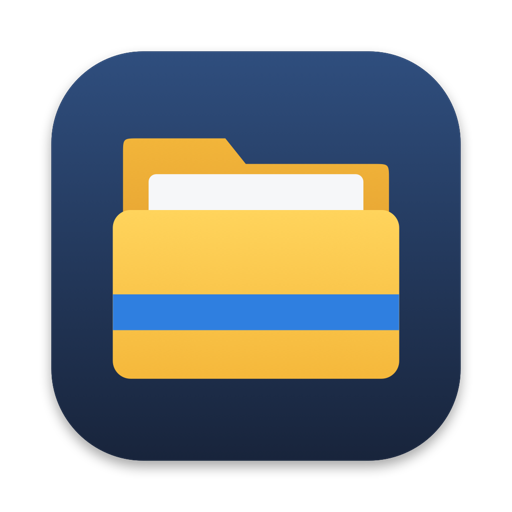
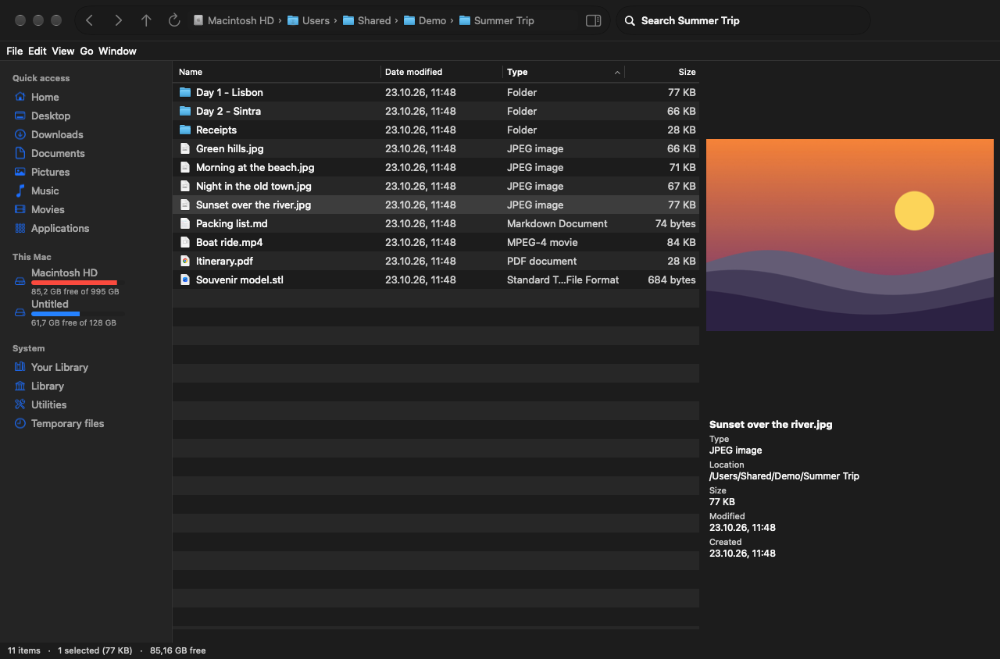
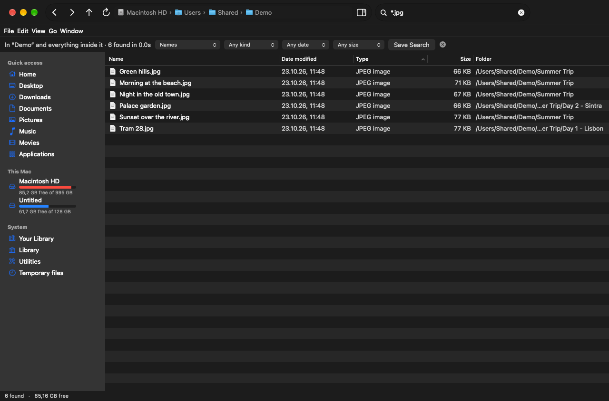
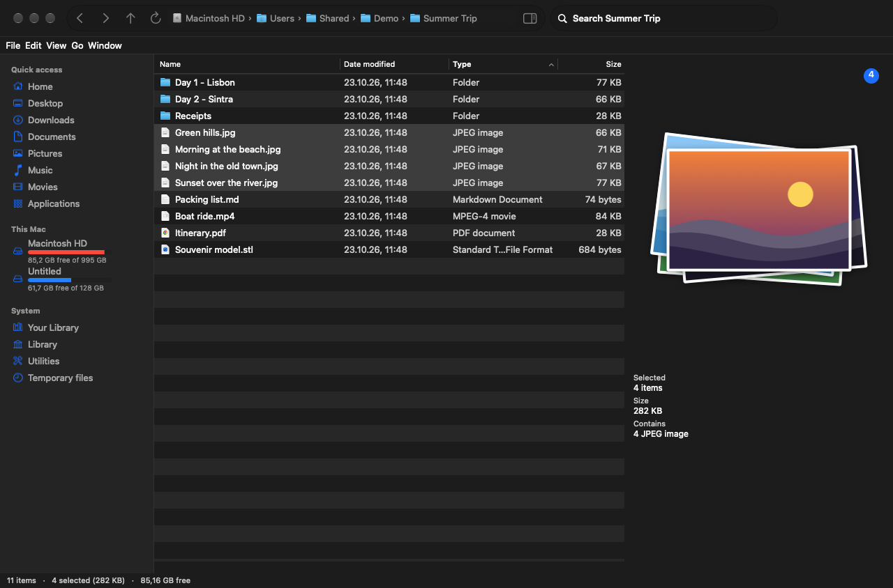

<p align="center"></p>

<h1 align="center">Elxplorer</h1>

<p align="center"><b>A file browser for the Mac that works like Windows Explorer.</b><br>
Real cut & paste, Enter opens, F2 renames, a typeable address bar, and search you can predict.</p>

<p align="center">
  <a href="https://github.com/eladitz/elxplorer/releases/latest/download/Elxplorer.dmg"><b>Download for Mac</b></a> ·
  <a href="https://ai.itzkin.com/elxplorer.html">Website</a> ·
  <a href="https://ko-fi.com/eladitzkin">Support on Ko-fi ☕</a>
</p>

<p align="center"></p>

Free and open source. Apple Silicon and Intel, macOS 14 Sonoma or later.

## Why

Finder is a fine app with habits that trip up anyone coming from Windows, or anyone with a lot of files.
Elxplorer takes the ten most common Finder complaints and answers each one:

| Finder complaint | Elxplorer |
|---|---|
| Search is unpredictable | Searches **this folder and everything inside it, by name**, without relying on Spotlight. Says where it's looking, shows each result's folder, supports `*` and `?` wildcards, filters by kind, date and size, optional name & contents, and **saved searches**. |
| Folder views don't stick | One set of columns, sort and view for **every** folder. Window size remembered. |
| Basic operations are odd | **⌘X / ⌘C / ⌘V** cut, copy and move files. **Enter opens**, **F2 renames**, Backspace goes back. **New ▸ Text Document** and friends. "name - Copy" when a name is taken. |
| Navigation takes too many steps | Breadcrumbs that **turn into a typeable path** (click the bar or ⌘L, Tab completes). Back / Forward / Up. System and hidden locations one click away. |
| Organisation is restrictive | Sort by any column, **group by type or date**, Tags column, **Pin to Quick access**; your Finder favourites appear too. |
| Tabs and windows get chaotic | Real tabs; opening a folder that's already open **reuses its tab**; new windows open on the screen you're using; tabs come back after a restart. |
| Large folders are slow | Folders load in the background, only visible rows are drawn, the list updates live. **Folder sizes** are measured in the background. |
| Too little customisation | Customisable toolbar, Explorer-style menu bar in the window, rich right-click menu (Copy as Path, Open in Terminal, Compress, Open With…), every shortcut remappable in System Settings. |
| Previews and metadata are limited | A **preview pane** that opens by itself for pictures, video, audio, **PDF, text and code, and 3D models** (STL, OBJ, PLY, USDZ…), with details such as dimensions, camera, duration and pages. Several files show as a **pile**, newest on top. |
| Bugs and odd layouts | Plain, standard AppKit; the window never resizes itself. |

<p align="center">
  
  
</p>

## Keys

| | |
|---|---|
| Open | Enter |
| Rename | F2 |
| Back / Up | Backspace / ⌘↑ |
| Cut / Copy / Paste files | ⌘X / ⌘C / ⌘V |
| Copy as path | ⌥⌘C |
| To the Trash / delete permanently | ⌘⌫ / ⇧fn⌫ (asks first) |
| Type a path | ⌘L |
| Search here | ⌘F |
| New folder / new text document | ⇧⌘N / ⌥⌘N |
| Hidden files | ⇧⌘. |
| Preview pane | ⌥⌘P |
| Details / Large icons | ⌘1 / ⌘2 |
| Properties | ⌘I |
| Quick Look | Space |

Drives show a capacity bar like "This PC"; hover for the numbers, right-click ▸ **More Info** for the details.

## Works with Elconvo

If [Elconvo](https://github.com/eladitz/elconvo) is installed, right-click files for **Convert with Elconvo ▸** and **Elconvo Tools ▸** (compress, crop, remove background, batch rename…), or **⌥-right-click** to open Elconvo's wheel right at the pointer.

## Install

1. [Download Elxplorer.dmg](https://github.com/eladitz/elxplorer/releases/latest/download/Elxplorer.dmg), open it and drag **Elxplorer** into **Applications**.
2. The app isn't signed with an Apple Developer ID yet, so the first time macOS will refuse to open it. Go to **System Settings ▸ Privacy & Security** and click **Open Anyway**. Once.
3. Optional: **Elxplorer menu ▸ Make Elxplorer the Default File Browser**, so folders and most apps' "Show in Finder" open here. **Restore Finder as Default** undoes it. The desktop and the Trash stay with Finder; macOS doesn't let any app replace those.

## Build from source

Needs only the Xcode Command Line Tools (`xcode-select --install`).

```sh
./build.sh      # build/Elxplorer.app (Apple Silicon + Intel)
./package.sh    # build/Elxplorer.dmg
```

| File | What's in it |
|---|---|
| `Sources/App.swift` | Menus, windows and tabs, session restore, default file browser |
| `Sources/Browser.swift` | One window: toolbar, panes, search, every file action |
| `Sources/FileList.swift` | Details table and Large icons grid, keys, drag and drop |
| `Sources/Sidebar.swift` | Quick access, This Mac, system locations, saved searches |
| `Sources/AddressBar.swift` | Breadcrumbs that turn into a typeable path |
| `Sources/Search.swift` | Name search, wildcards, filters, Spotlight contents search |
| `Sources/Preview.swift` | Preview pane: pictures, video, PDF, text, 3D, the pile |
| `Sources/Drive.swift` | Drive space and More Info |
| `Sources/Model.swift` | Files, settings, folder sizes, cut/copy/paste, file operations |
| `Sources/Elconvo.swift` | Talking to Elconvo |

## Support

Elxplorer is free and made by one person. If it makes your Mac nicer to use, a coffee on **[Ko-fi](https://ko-fi.com/eladitzkin)** keeps it going.

Made by Elad Itzkin · [ai.itzkin.com](https://ai.itzkin.com) · [elad.itzkin.com](https://elad.itzkin.com). MIT licensed.
